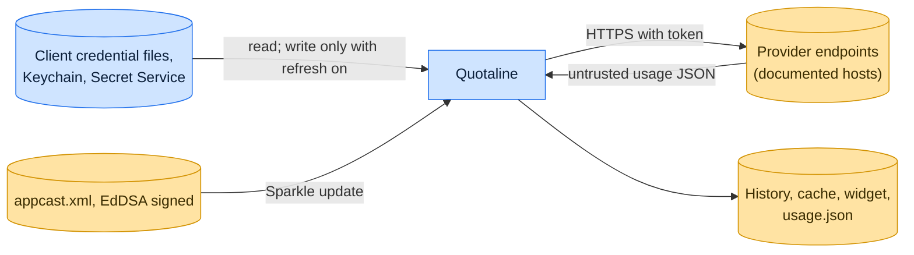

# Threat model

This model says what Quotaline trusts, where untrusted input enters, and which guarantees hold at each boundary, so a
report can be classified as a vulnerability or a bug. [SECURITY.md](SECURITY.md) covers reporting; if the two disagree,
SECURITY.md wins and we fix this file.

## How Quotaline works

Quotaline reads the credentials of six AI coding tools (Claude, Codex, Gemini CLI, Antigravity, Cursor, GitHub Copilot)
from their client files, the macOS Keychain or the GNOME Secret Service, calls each provider's usage endpoints, and
shows quotas in the menu bar or GNOME panel with local history. Token refresh, which writes renewed credentials back to
the source, is off by default. Direct macOS builds update through Sparkle from an EdDSA-signed appcast; the App Store
build updates through the App Store.

## Compared with similar tools

We drew the boundary where comparable projects in other ecosystems draw theirs. The shared rule, stated by the
[Node.js threat model](https://github.com/nodejs/node/blob/main/SECURITY.md#the-nodejs-threat-model), is that a report
which first needs a trusted element compromised is out of scope; the first triage question, as
[DOMPurify](https://github.com/cure53/DOMPurify/blob/main/SECURITY.md#what-we-consider-a-vulnerability) puts it, is what
the attacker controls.

| Project                                                  | Language              | Where it draws the line                                                                                |
| -------------------------------------------------------- | --------------------- | ------------------------------------------------------------------------------------------------------ |
| [GitHub CLI](https://github.com/cli/cli/security/policy) | Go                    | Reads and stores account tokens; a dependency CVE counts only with evidence it is reachable from `gh`. |
| [Sparkle](https://sparkle-project.org/documentation/)    | Objective-C and Swift | The update framework Quotaline uses; updates are accepted only when signed with the app's EdDSA key.   |
| [CodexBar](https://github.com/steipete/CodexBar)         | Swift                 | A similar menu bar quota app; it publishes no security policy, so the line here is our own.            |

## Trusted

An attacker who controls any of these already has what Quotaline could give them:

- The logged-in user, their unlocked Keychain and keyring, and the provider clients that own the credentials.
- The app's launch environment, which can carry a Copilot token.
- macOS, GNOME Shell, and the signing identities used to build releases.

## Untrusted inputs

| Input                | Comes from                                                  | What Quotaline guarantees                                                             |
| -------------------- | ----------------------------------------------------------- | ------------------------------------------------------------------------------------- |
| Provider responses   | Provider APIs and Antigravity's discovered loopback service | Parsed as data; displayed values cannot change which host credentials go to.          |
| Update feed          | GitHub Releases `appcast.xml`                               | Sparkle installs only updates signed with the app's EdDSA public key.                 |
| Shared machine state | Other local users                                           | Data lives in the user's own Application Support, config, data and cache directories. |

## Threats and controls

| STRIDE                 | Threat                                                         | Control                                                                                                   |
| ---------------------- | -------------------------------------------------------------- | --------------------------------------------------------------------------------------------------------- |
| Information disclosure | A token appears in copied diagnostics or logs.                 | Logs sanitize URLs and sensitive values; the HTTP logger records no headers or bodies.                    |
| Spoofing               | A forged update replaces the app.                              | EdDSA-signed appcast and notarized Developer ID builds.                                                   |
| Tampering              | Refresh overwrites a CLI's credential unexpectedly.            | Refresh is off by default and limited to Claude, Codex and Gemini sources.                                |
| Elevation of privilege | A provider response steers a request with the token elsewhere. | Requests go only to the documented provider destinations; Copilot enterprise hosts only where configured. |

## Release chain

Releases are built by the release workflow from a tag the release App creates. macOS Direct and Homebrew builds are
Developer ID signed and notarized, the appcast is signed with the Sparkle EdDSA key, the App Store build goes through
App Store review, and the GNOME tarball ships with a SHA-256 file on the immutable GitHub Release.

## Vulnerability or bug

| Report                                              | Verdict             | Why                                        |
| --------------------------------------------------- | ------------------- | ------------------------------------------ |
| Copy Diagnostics includes an OAuth token            | Vulnerability       | Credential disclosure.                     |
| Codex quota shows the wrong percentage              | Bug                 | Product correctness, no data exposed.      |
| Account A's usage shows under account B             | Vulnerability       | Account mixing.                            |
| Malware running as the user reads the Keychain item | Not a vulnerability | Unlocked account and Keychain are trusted. |

## Accepted risks

- Hiding account details masks the display, not the files on disk.
- Refreshing a shared credential can invalidate the copy a running CLI holds.

## Keeping this current

Revisit this model when Quotaline gains a new input source, network access, a new way to run code, or a new place it
writes to, and whenever an advisory is published.
