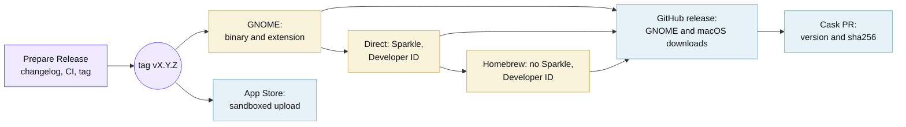

Add one named fragment per user-facing change, such as `changelog.d/+codex-balance.feature.md`. Use `feature` for added
or removed platform support, `bugfix` for corrected behavior, `doc` for reader-facing documentation, and `change` for a
behavior change. The other supported categories are `breaking`, `security`, `performance`, `deprecation`, `removal`, and
`packaging`. Write the outcome in the fragment; the release process links its squash PR and credits human authors. The
[changelog](/changelog/) shows pending fragments under Draft on a pull request build.

Apply `skip news` to a change with no end-user effect, including tooling-only work. The label can be added after opening
the PR. Bot PRs receive it automatically unless they add a fragment. A bot-authored fragment is still checked and
published without bot credit. Run **Prepare Release** (`just macos-release`, or the Actions tab) after merging the
changes. It derives the next `vX.Y.Z` tag from fragments, commits the changelog, runs full CI on that commit, and pushes
the tag only after CI passes. `major`, `minor`, or `patch` can override the automatic bump; no version is typed into the
form.

Quotaline keeps the package version in its Rust manifests and Xcode project. Before preparing a release, keep these
source versions in sync with the version implied by the fragments. The workflow checks all Rust package versions and
both Xcode version fields before any write, and stops if they differ. Because this repository has no tags yet, its first
release uses the latest tracked changelog version, `0.1.7`, as the comparison baseline. The repository-only release App
pushes the tag, which starts **Release**. Before signing, that workflow verifies the requested tag exists and points to
the checked-out commit. One run publishes the GNOME download and all three macOS channels:

The cask job opens a pull request with the new version and checksum after the GitHub Release exists. Merging that PR
updates `main`. GitHub publication verifies the tag's commit, exact notes, and SHA256 digest of all 12 expected assets.
A failed asset upload leaves a draft for retry; a retry rejects changed notes or assets.

The Direct job needs signing credentials and [Sparkle](https://sparkle-project.org) keys. The App Store credential check
runs only on the App Store path. Its upload can finish before Apple processes the build; it does not delay the GitHub
Release or cask PR. Inspect both paths before treating the release as complete.

Versions 0.1.0 through 0.1.7 were published from the archived macOS repository. The new repository has no tags or GitHub
Releases for those versions. The first release here must be checked against the GNOME download, macOS downloads, cask
PR, and App Store upload before considering the new pipeline complete.

The release runs no application tests of its own. It reads the CI verdict for the tagged commit and refuses to publish
unless the newest run passed, so a tag carries the full matrix for macOS 15 and 26, plus macOS 27 when its runner image
is available. Everything the release still checks concerns the artifact instead of behaviour: deployment targets, both
architecture slices, Mach-O validity, updater load commands, notarization and the appcast signature.

The three channels are separate Xcode application targets. Only Direct compiles and links `SparkleUpdater`; Homebrew and
App Store do not link the Sparkle product and carry no Sparkle keys in `Info.plist`. Release verification checks both
arm64 and x86_64 slices, Mach-O validity, and updater load commands in the app, zip, and disk image without launching
the application.

### What Apple needs

Enrol in the [Apple Developer Program](https://developer.apple.com/programs/), then create these and store each in the
`release`
[environment](https://docs.github.com/en/actions/how-tos/deploy/configure-and-manage-deployments/manage-environments),
which only `main` and `v*` tags can deploy to. Every job that reads a signing identity names that environment, so a pull
request build cannot reach one:

- `DEVELOPER_ID_CERTIFICATE_BASE64` and `DEVELOPER_ID_CERTIFICATE_PASSWORD`: a **Developer ID Application** certificate
  exported from Keychain Access as a base64-encoded `.p12`.
- `APPLE_DISTRIBUTION_CERTIFICATE_BASE64` and `APPLE_DISTRIBUTION_CERTIFICATE_PASSWORD`: an **Apple Distribution**
  certificate exported the same way.
- `MAC_INSTALLER_DISTRIBUTION_CERTIFICATE_BASE64` and `MAC_INSTALLER_DISTRIBUTION_CERTIFICATE_PASSWORD`: a **Mac
  Installer Distribution** certificate exported the same way.
- `APP_STORE_PROVISIONING_PROFILE_BASE64` and `APP_STORE_WIDGET_PROVISIONING_PROFILE_BASE64`: Mac App Store profiles for
  `tech.bernat.quotaline` and its widget extension.
- `APPLE_TEAM_ID`: the ten-character identifier on the [membership page](https://developer.apple.com/account).
- `APP_STORE_CONNECT_KEY_ID`, `APP_STORE_CONNECT_ISSUER_ID`, and `APP_STORE_CONNECT_KEY_BASE64`: a base64-encoded
  [App Store Connect API key](https://appstoreconnect.apple.com/access/integrations/api) with the App Manager role.
- `SPARKLE_PUBLIC_ED_KEY` and `SPARKLE_PRIVATE_ED_KEY`: keys from Sparkle's `generate_keys` command.

The app record in [App Store Connect](https://appstoreconnect.apple.com) has to exist under the same bundle identifier
before the first upload, along with a `tech.bernat.quotaline` App ID and an app group for the widget.

[Renovate](https://docs.renovatebot.com) opens a grouped pull request each week for the pinned tools, the action digests
and the Swift packages. Read the Docs publishes the site using `.readthedocs.yaml`; CI validates the site build. Preview
and versioned URLs include a base path, so internal links must use Hugo page URLs.
